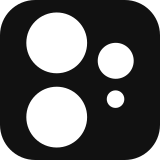

<div align="center">
  
  <h1>NotiCam</h1>
  <p><b>Hardware-direct, full-sensor camera app built for the CMF Phone 2 Pro.</b></p>
  <p>Minimal post-processing, authentic sensor readout, and zero artificial upscaling.</p>

  <p>
    <a href="https://github.com/ZenithFr/NotiCam/releases/tag/v2.0a-alpha">
      
    </a>
    
    
  </p>
</div>

---

## Features

- **Open Gate RAW:** Full-sensor active array Bayer DNG readout without digital cropping across all physical lenses (`1×`, `2×`, and `0.6×`).
- **4K & 8K Resolution Switching:** Instant one-tap switching between native 4K (12 MP) and full-sensor 8K (50 MP) remosaic capture.
- **Multiple Capture Formats:** Support for native Quality-100 JPEG, uncompressed 16-bit RAW (DNG), and uncompressed 4K/8K planar YUV 4:2:0.
- **Direct Sensor Controls:** Manual focus distance slider, ISO and shutter speed stop snapping, and Kelvin white balance adjustment.
- **Native Lens Routing:** Hardware-level physical camera switching without intermediate sensor interpolation.
- **Built-in Media Viewer:** High-performance, private, hardware-accelerated media viewer with zero cloud telemetry.

---

## Requirements

1. **Device:** CMF Phone 2 Pro (arm64-v8a) running Nothing OS / Android.
2. **Android Version:** Android 10 or newer (API 29+).
3. **Shizuku:** Running Shizuku service is required to manage privileged Camera2 sessions directly from the device shell.

---

## Installation & Setup

### 1. Set Up Shizuku
NotiCam uses Shizuku to communicate directly with OEM camera devices and bypass typical third-party API restrictions.

1. Download **[Shizuku](https://shizuku.rikka.app/)** from Google Play or GitHub.
2. Open Shizuku and follow the in-app instructions to start it via **Wireless Debugging** (recommended) or via PC with **ADB**:
   ```bash
   adb shell sh /sdcard/Android/data/moe.shizuku.privileged.api/start.sh
   ```
3. Ensure the Shizuku dashboard indicates *"Shizuku is running"*.

### 2. Install NotiCam
1. Download the latest APK from the **[Releases](https://github.com/ZenithFr/NotiCam/releases/tag/v2.0a-alpha)** page:
   - `NotiCam-v2.0a-alpha-arm64-v8a.apk`
2. Install the APK on your device:
   ```bash
   adb install -r NotiCam-v2.0a-alpha-arm64-v8a.apk
   ```
   *(or open the downloaded file in your Android file manager)*.
3. Launch NotiCam. When prompted, grant **Camera**, **Microphone**, and **Shizuku** permissions.

---

## Capture Modes

| Mode | Format | Resolution | Description |
|---|---|---|---|
| **Standard Photo** | JPEG (Quality 100) | 4K (12 MP) / 8K (50 MP) | Native ISP capture with direct hardware remosaicing. |
| **Open Gate RAW** | DNG (16-bit Bayer) | 4K Active Array | Full-sensor uncropped readout. Never software upscaled. |
| **YUV Frame Dump** | Planar YUV 4:2:0 | 4K / 8K | Uncompressed hardware YUV frames saved to `/sdcard/Pictures/NotiCam/`. |
| **Video** | H.264 MP4 | 1080p / 4K (24/30/60 fps) | High-bitrate native aspect video recording. |

---

## Building from Source

### Prerequisites
- JDK 17 & Gradle 8.9+
- Android SDK 35 (Build-tools 35.0.0)
- Android NDK `27.1.12297006`
- Python 3

### Build Commands
```bash
# Verify static contracts and test suite (143 checks)
./build.sh check

# Build debug APK
./build.sh debug

# Build signed release APK
./build.sh release
```
Outputs are located in `build/outputs/apk/`.

---

## License

Personal and experimental use only. All rights reserved.
